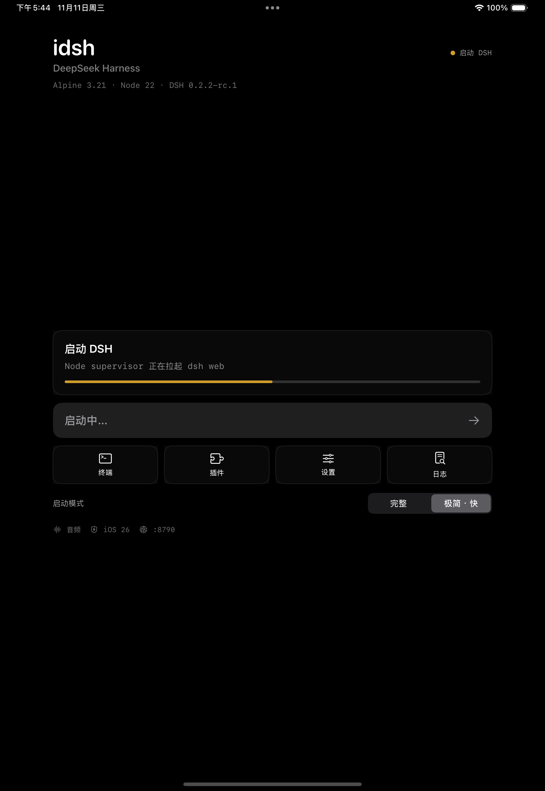

# idsh

**DeepSeek Harness on iPadOS / iOS — a self-hosted, sideloadable IPA.**

[简体中文](#简体中文) · [English](#english)



---

## 简体中文

### 这个项目的意义

> 苹果在2020年画了一张大饼，“你的下一台电脑，何必是电脑”。六年了，对于苹果官方来说，这张大饼还是大饼，但是开源社区的同志们前赴后继的奉献，现在一台高性能高存储的iPad在经过折腾以后已经可以基本达到PC的生产力要求了。而这个项目就是为了继续圆这个生态而生的，希望真的可以不用买电脑了，太贵了

`idsh` 把完整的 DeepSeek Harness 装进 iPad：iSH ARM64 用户态 Linux + 常驻 `dsh web` + WKWebView。它不是远程串流，也不是精简版客户端——浏览器里加载的就是桌面版 DSH 的同一套前端，iPad 上得到三栏桌面布局。

> ⚠️ **加载速度极慢。** 首次启动要解压约 1.1 GB 的 Alpine rootfs（2–3 分钟）；之后冷启动仍要 50–80 秒，极简模式约 69–77 秒。这不是 bug，是 iSH 解释执行 + DSH 0.2.2 约 95 个 Cordis 插件的固有成本。

### 已实现

- **iPad 与 PC 同款 UI**：WKWebView 直接加载 `dsh-web-frontend`，三栏、侧栏、终端面板都保留。
- **后台常驻**：静音音频保活 + iOS 26 `BGContinuedProcessingTask` + 后台 CPU governor；实测锁屏/切后台 25 分钟进程不退出。
- **插件系统**：`plugin_manager` 可用，纯 JS / npm Cordis 插件可安装；`pnpm` 由 npm 兼容 shim 承接（原因见 `Docs/RELEASE.md`），真实 pnpm 保留为 `pnpm.real`。
- **分享面板**：iOS 分享 → App Group → `/workspace/inbox/<id>` → 预填 DSH 输入框；DSH 未启动时排队。
- **DSH 更新**：设置页检查 npm 最新版，并可执行 `dsh-update` 后重启。
- **启动模式**：完整 / 极简 · 快，启动器与设置页可切换。
- **后台准备 / 断点续解压**：启动期间可切到其他 App；解压按块记录进度，中断后从断点继续。
- **性能 HUD**：右上角浮层显示 FPS、内存、热状态与电量；设置页可开关。
- **配置文件编辑器**：在 App 内直接编辑 `/root/.dsh/profiles/web` 下的配置并重启 DSH，替代桌面版“打开配置文件”入口。
- **登录**：DSH Web 宿主不提供交互式 OAuth 回调，账号登录会返回 `protocol` 错误；请用 API Key（设置页有说明）。

### 快速开始

1. 从 [Releases](https://github.com/LunWhale/idsh/releases) 下载 `idsh-unsigned.ipa`。
2. 用 SideStore / AltStore / Sideloadly 自签安装（免费 Apple ID 7 天；付费账号可 1 年 Ad Hoc）。
3. 首次启动解压约 1.1 GB Alpine rootfs，约 2–3 分钟；之后冷启动约 50–80 秒。
4. 进入 DSH 后添加 DeepSeek API Key。

> 未签名 IPA 不能在未越狱设备上直接安装，也不要用 TrollStore（iOS 26 已不支持）。

### 启动模式

| 模式 | 行为 | 实测（iPad 模拟器） |
|---|---|---|
| 完整 | 加载全部 Cordis 插件 | 82–97 秒 |
| 极简 · 快 | `--patch fast.patch.yml` 关闭约 68 个非核心插件，保留会话、工作区、文件、核心工具、终端、插件管理器 | 69–77 秒 |

极简模式只影响启动时加载的插件，不改 rootfs、不改已安装插件；切回完整并重启即恢复。切换会在 DSH ready 后自动重启。

### 从源码构建

要求：macOS 26、Xcode 26.2、XcodeGen、Node.js；构建引擎还需要 meson / ninja / LLVM / libarchive。

```bash
git clone https://github.com/LunWhale/idsh.git
cd idsh
xcodegen generate --spec app/project.yml
# app/Resources/alpine-rootfs.zip 体积过大，未入库；见 Docs/ROOTFS.md
bash scripts/make-ipa.sh
```

仓库已带 `app/Vendor/HarnessISH.xcframework`（自建引擎，已移除 iSH 的 60s/180s 空闲自杀阀），所以普通构建不需要重编引擎。重新构建引擎见 `Docs/ISH-ENGINE-VALVES.md`。

### 架构

```text
SwiftUI 启动器
 ├─ ISHRootfsInstaller   解压 Alpine fakefs（ZIP64）
 ├─ ISHKernel            iSH ARM64 内核 + fakefs + 网络
 ├─ dsh-supervisor.mjs   常驻 dsh web :8790，写 /tmp/dsh.url
 ├─ WKWebView            加载 dsh-web-frontend（PC 同款）
 └─ BackgroundKeeper     音频保活、iOS 26 continued、CPU governor
```

### 仓库结构

```text
app/                         SwiftUI App、分享扩展、WKWebView、后台
  Vendor/HarnessISH.xcframework   自建 ish-arm64 引擎
  Resources/RootfsPatch.bundle    guest 内补丁（fetch polyfill、supervisor、fast.patch.yml）
scripts/dsh-supervisor.mjs   guest 内 DSH 守护进程
scripts/pnpm-npm-shim.js     pnpm -> npm 兼容层
scripts/make-ipa.sh          未签名 IPA 打包
build/idsh-engine-fixes.py   移除引擎空闲自杀阀 + waitpid EINTR 修复
patches/                     dsh-web-app early-url 补丁
Docs/RELEASE.md              构建、签名、已知限制
Docs/ROOTFS.md               rootfs 复现步骤
Docs/ISH-ENGINE-VALVES.md    引擎问题与修复记录
```

### 已知限制

- 只支持纯 JS / npm 插件；iOS 上无法加载 `.node` 原生 addon（node-pty、sherpa、libreoffice 等），Office 文档转换在 `--jitless` 下也不可用。
- 冷启动仍是 50–80 秒：DSH 0.2.2 有约 95 个 Cordis 插件，iSH 是解释执行；极简模式只能省约 20%。
- DSH 设置页的「打开配置文件」是桌面宿主专用操作，在 Web 宿主会报错；请用启动器「设置 → 配置文件」或直接添加模型提供商。添加模型不需要编辑配置文件。
- iPhone 只做可用性适配，不重排桌面布局；主要目标是 iPad。
- OAuth 登录不可用；API Key 是唯一方式。
- 未签名 IPA 需自签；免费证书 7 天有效。

### 许可

GPL-3.0。原因：链接了 iSH / ish-arm64 / OpenMinis 的 GPL 代码。第三方说明见 [`NOTICE`](NOTICE)。

---

## English

### Why this project exists

> In 2020 Apple painted a big picture: “Your next computer is not a computer.” Six years later, for Apple itself that picture is still just a picture. But thanks to the unending contributions of the open-source community, a high-performance, high-capacity iPad can now, after some tinkering, basically meet PC productivity requirements. This project exists to keep that ecosystem going — in the hope that we really won't need to buy a computer. They're too expensive.

`idsh` puts the full DeepSeek Harness on an iPad: an iSH ARM64 user-mode Linux, a long-running `dsh web`, and a WKWebView. It is not remote streaming and not a cut-down client — the WebView loads the same frontend as the desktop app, so the iPad gets the real three-column layout.

> ⚠️ **Startup is extremely slow.** The first launch extracts a ~1.1 GB Alpine rootfs (2–3 min); later cold starts still take 50–80 s, or 69–77 s in minimal mode. This is not a bug: iSH interprets every instruction, and DSH 0.2.2 loads about 95 Cordis plugins.

### What works

- **Desktop UI on iPad**: WKWebView loads `dsh-web-frontend` unchanged.
- **Background survival**: silent-audio keep-alive + iOS 26 `BGContinuedProcessingTask` + background CPU governor. A 25-minute background soak kept the process alive.
- **Plugins**: `plugin_manager` works with pure-JS/npm Cordis plugins. `pnpm` is backed by an npm-compatible shim (see `Docs/RELEASE.md`); the real pnpm stays at `pnpm.real`.
- **Share sheet**: iOS share → App Group → `/workspace/inbox/<id>` → prefilled DSH composer; queued when DSH is not running.
- **DSH updates**: the settings page checks npm and can run `dsh-update` then restart.
- **Startup modes**: Full / Minimal-Fast, switchable from the launcher and settings.
- **Background preparation / resumable extraction**: leave the app while it prepares; extraction checkpoints and resumes after interruption.
- **Performance HUD**: top-right FPS / memory / thermal / battery overlay; toggle in settings.
- **Config editor**: edit files under `/root/.dsh/profiles/web` in-app and restart DSH — replaces the desktop-only "open configuration file" entry.
- **Sign-in**: the DSH web host has no interactive OAuth callback and returns `protocol`; use an API key instead.

### Quick start

1. Download `idsh-unsigned.ipa` from [Releases](https://github.com/LunWhale/idsh/releases).
2. Sideload with SideStore / AltStore / Sideloadly (free Apple ID: 7 days; paid: 1-year Ad Hoc).
3. First launch extracts a ~1.1 GB Alpine rootfs (2–3 min); later cold starts take 50–80 s.
4. Add a DeepSeek API key inside DSH.

### Startup modes

| Mode | Behavior | iPad simulator |
|---|---|---|
| Full | Loads every Cordis plugin | 82–97 s |
| Minimal-Fast | `--patch fast.patch.yml` disables ~68 non-core plugins; keeps sessions, workspace, files, core tools, terminal, plugin manager | 69–77 s |

Minimal mode only changes what is loaded at boot. It does not touch the rootfs or installed plugins; switch back to Full and restart to restore everything. Switching restarts DSH once it is ready.

### Build from source

Requirements: macOS 26, Xcode 26.2, XcodeGen, Node.js; rebuilding the engine also needs meson / ninja / LLVM / libarchive.

```bash
git clone https://github.com/LunWhale/idsh.git
cd idsh
xcodegen generate --spec app/project.yml
# app/Resources/alpine-rootfs.zip is too large for git; see Docs/ROOTFS.md
bash scripts/make-ipa.sh
```

The repository ships `app/Vendor/HarnessISH.xcframework` (our engine build with the iSH 60 s/180 s idle-kill valves removed), so a normal build does not need to rebuild the engine. See `Docs/ISH-ENGINE-VALVES.md` for that path.

### Architecture

```text
SwiftUI launcher
 ├─ ISHRootfsInstaller   extracts the Alpine fakefs (ZIP64)
 ├─ ISHKernel            iSH ARM64 kernel + fakefs + networking
 ├─ dsh-supervisor.mjs   keeps dsh web on :8790 and writes /tmp/dsh.url
 ├─ WKWebView            loads dsh-web-frontend (same as desktop)
 └─ BackgroundKeeper     audio keep-alive, iOS 26 continued task, CPU governor
```

### Layout

```text
app/                         SwiftUI app, share extension, WKWebView, background
  Vendor/HarnessISH.xcframework   our ish-arm64 engine
  Resources/RootfsPatch.bundle   guest patches (fetch polyfill, supervisor, fast.patch.yml)
scripts/dsh-supervisor.mjs   guest-side DSH supervisor
scripts/pnpm-npm-shim.js     pnpm -> npm compatibility layer
scripts/make-ipa.sh          unsigned IPA packaging
build/idsh-engine-fixes.py   engine idle-valve removal + waitpid EINTR fix
patches/                     dsh-web-app early-url patch
Docs/RELEASE.md              build, signing, known limitations
Docs/ROOTFS.md               rootfs reproduction
Docs/ISH-ENGINE-VALVES.md    engine findings and fixes
```

### Known limitations

- Pure-JS/npm plugins only; `.node` native addons cannot load on iOS (node-pty, sherpa, libreoffice). Office conversion is also unavailable under `--jitless`.
- Cold start is 50–80 s: DSH 0.2.2 loads ~95 Cordis plugins and iSH is an interpreter; minimal mode saves about 20%.
- DSH's "open configuration file" is a desktop-host-only action and fails in the web host. Use the launcher's Settings → Configuration instead; adding a model provider does not require editing files.
- iPhone is best-effort; the desktop layout is not reflowed. iPad is the target.
- OAuth sign-in is unavailable; API key only.
- The IPA is unsigned and must be sideloaded; free certificates expire after 7 days.

### License

GPL-3.0, because the binary links GPL-3.0 code from iSH / ish-arm64 / OpenMinis. See [`NOTICE`](NOTICE).

---

Not affiliated with DeepSeek or Apple. “DeepSeek Harness” is a project of its respective authors.
